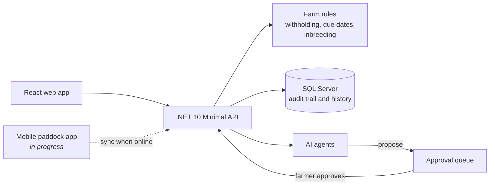

# Paddock Pal

**Livestock management for a working sheep flock, plus a mobile app for the paddock.**

> The source code is private. This repository describes the project. I'm happy to walk through the code in person.

---

## The problem

We run a small lifestyle block with a sheep flock. Farming at our scale doesn't bring the demands of large-scale paddock rotation, but there's still plenty to keep track of:

- which animals are due for treatment, and when
- which ewes can go to the ram, and at what stage
- how each animal is related to the rest of the flock

We kept this in spreadsheets, and they broke down exactly when it mattered: at lambing, at treatment time, and when choosing breeding pairs. Paddock Pal turns those scattered records into clear, timely decisions.

## My role

**Product owner and lead developer.** I shaped the product from first-hand farm experience, set the requirements, made the architectural and business-rule decisions, and took it from concept to a working system that we use on our own farm.

## Stack

| Area | Technology |
| --- | --- |
| API | .NET 10 Minimal APIs, Entity Framework Core |
| Data | SQL Server / Azure SQL |
| Web app | React, TypeScript |
| Orchestration | .NET Aspire |
| AI agents | Microsoft Agent Framework; Ollama locally, Claude when quality matters |
| CI | GitHub Actions |
| Access | Self-hosted, reached securely over Tailscale |

## Architecture

## Key decisions

**Farm rules are calculated, not guessed.**
Withholding periods, due dates and inbreeding coefficients are worked out by plain, unit-tested C#, never by an AI model. These are the numbers that matter for animal welfare and food safety, so they have to be exact and explainable.

**AI proposes, a person decides.**
AI agents research and suggest things like breeding and treatment plans. Every proposal waits for the farmer's approval. Agents show in the audit trail as separate actors from users, so every suggestion can be traced back to where it came from. Models can be swapped: Ollama runs locally during development, and Claude is used when quality matters.

**Built for trust.**
Soft deletes, temporal history and a full audit trail mean nothing is silently lost or changed, so the system catches what a tired part-time farmer might miss.

**Species-neutral model.**
The data model doesn't assume sheep, so cattle or alpacas can be added without a rewrite.

## Quality

- Domain rule tests for every farm calculation
- API integration tests against a real SQL Server in a container
- Evaluations for the AI agents
- Everything runs in CI on GitHub Actions

I used Claude Code across planning, implementation, testing and documentation. Every technical decision stayed with me.

## Now building: the paddock app

A companion mobile app for use out in the paddock:

- **Offline-first**, for patchy rural coverage. Changes are queued on the device and sync automatically when coverage or Wi-Fi returns.
- **Voice-driven recording.** The goal: identify an animal, record a treatment, add notes and schedule follow-ups such as booster vaccinations, all without putting down the drench gun.

## Screenshots

*Screenshots use demo data, not our real flock.*

| Animal record | Treatment entry |
| --- | --- |
|  |  |

| AI proposal awaiting approval | Paddock app (in progress) |
| --- | --- |
|  |  |

## Status

- **Web platform:** in everyday use on our farm
- **Mobile paddock app:** in development

---

**Mercia Zaayman**, Senior Software Engineer | AI-Assisted Engineer · [Portfolio](https://mercia-coder.github.io/Portfolio/) · [LinkedIn](https://linkedin.com/in/mercia-zaayman)

© Mercia Zaayman. All rights reserved. This repository is shared for viewing only.
