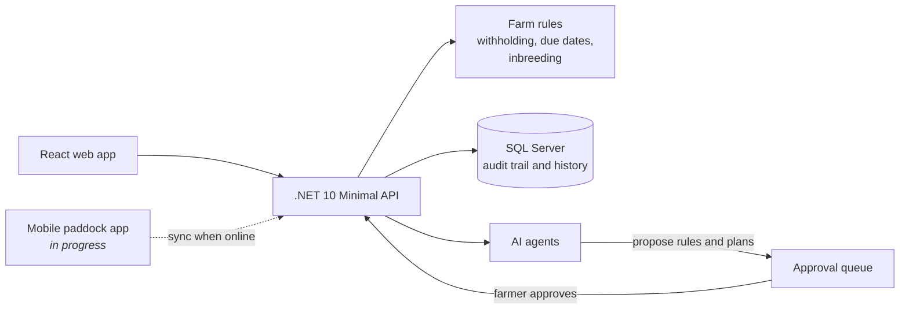

# Paddock Pal

**Livestock management for a working sheep flock, plus a mobile app for the paddock.**

> The source code is private. This repository describes the project. I'm happy to walk through the code in person.

---

## The problem

We used to manage our flock in a spreadsheet and take a printout down to the paddock at treatment time. Picture it: hunting for the right sheep number on a small sheet of paper the wind keeps trying to steal, forgetting which pocket the pen is in, and digging out reading glasses to make it all work. By the end of a session with just 19 sheep, the page was covered in grass and sheep poo – and I still had to go back up to the house and update the spreadsheet by hand.

On top of that was the constant juggling: which lamb is due for its booster vaccination, and which ewe is ready to go in with the ram. I wanted one place that turns scattered records into clear, timely decisions.

## My role

**Product owner, lead developer and end user.** Requirements, architecture, business rules and delivery, from concept to a working system. As the person using it in the paddock, I feel every rough edge first-hand, and that feeds straight back into the product.

## Stack

| Area | Technology |
| --- | --- |
| API | .NET 10 Minimal APIs, Entity Framework Core |
| Data | SQL Server / Azure SQL |
| Web app | React, TypeScript |
| Orchestration | .NET Aspire |
| AI agents | Microsoft Agent Framework; Ollama locally, Claude when quality matters |
| CI | GitHub Actions |
| Access | Self-hosted, reached securely over Tailscale |

## Architecture

## Key decisions

**AI researches the rules, code applies them.**
An AI research agent helps set up the farm rules, such as product withholding periods and vaccination schedules, by researching them and looking at our current flock data. Once a rule is approved, the day-to-day numbers – withholding periods, due dates and inbreeding coefficients – are calculated by plain, unit-tested C#. These are the numbers that matter for animal welfare and food safety, so they have to be exact, repeatable and explainable.

**AI proposes, a person decides.**
AI agents research and suggest things like breeding and treatment plans. Every proposal waits for the farmer's approval. Agents show in the audit trail as separate actors from users, so every suggestion can be traced back to where it came from. Models can be swapped: Ollama runs locally during development, and Claude is used when quality matters.

**Built for trust.**
Soft deletes, temporal history and a full audit trail mean nothing is silently lost or changed, so the system catches what a tired part-time farmer might miss.

**Species-neutral model.**
The data model doesn't assume sheep, so cattle or alpacas can be added without a rewrite.

## Quality

- Domain rule tests for every farm calculation
- API integration tests against a real SQL Server in a container
- Evaluations for the AI agents
- Everything runs in CI on GitHub Actions

I used Claude Code across planning, implementation, testing and documentation. Every technical decision stayed with me.

## Next steps

**Mobile paddock app**
A companion app for use out in the paddock:
- **Offline-first**, for patchy rural coverage. Changes are queued on the device and sync automatically when coverage or Wi-Fi returns.
- **Voice-driven recording.** The goal: identify an animal, record a treatment, add notes and schedule follow-ups such as booster vaccinations, all without putting down the drench gun.

**Tailscale across our home computers**
Secure, private access to Paddock Pal from every computer in the house, not just one.

**Onboarding process**
A guided setup so a new user can add their farm, flock and treatment products without needing me beside them.

**User manuals**
Short, practical guides written for farmers, not developers.

## Screenshots

*Screenshots are from our own farm. Other people's names and contact details are blurred.*

**Home:** what needs attention today – overdue treatments, the flock count, planned departures, breeding risks, upcoming lambing and this week's tasks.

**Flock:** every animal in the paddock, filterable by status and owner and exportable as a stock sheet, with overdue and breeding-risk flags. *(Co-owner names blurred.)*

| Case file, closed | Case file, open |
| --- | --- |
|  |  |

Each animal has its own case file. Closed, it shows a quick summary. Open, the tag shows in its real colour and ear – left ear for males, orange for 2026 lambs – so sex and age are clear at a glance, with breeding risks pinned alongside.

| Treatment record | |
| --- | --- |
|  | |

The treatment record lists every treatment and event from arrival to departure, with due and overdue items on top.

### Recording a lambing

From the ewe's case file to a new case file for every lamb, with its inbreeding risk and first treatments set up automatically.

| Lambing section in the ewe's case file | Record a lambing |
| --- | --- |
|  |  |

1. Lambings and departures each have their own section in the ewe's case file.
2. Record a lambing: sire, any help needed, and each lamb's sex and coat. The number and name can wait until tagging.

| Two lambs recorded | Lamb's own case file |
| --- | --- |
|  |  |

3. Two lambs recorded for 021 Debby.
4. A case file is created for each lamb, with a blank tag until it's tagged and its inbreeding coefficient worked out from the recorded parents.

| First treatments planned automatically | |
| --- | --- |
|  | |

5. The lamb's first treatments are planned automatically by sex. This ram lamb gets vaccination, tagging, tail docking and castration.

### Treatment rounds

Treatments that belong together are grouped into one round automatically, or logged as a batch, so you head to the paddock with a clear list of who needs what. Only a person can mark them done.

### Breeding and joinings

Using the rules the AI research agent helped set up, Paddock Pal suggests when the next joining should be and checks every ewe against the ram: who can join this time, who can't, and why. Joinings and mating marks then work out when each ewe conceived and her expected lambing dates.

| A joining in progress | Mating marks |
| --- | --- |
|  |  |

### Contacts and money

Everyone the farm deals with, what they charge and the jobs they've done, rolled up into the year's money in and out. Extra costs like feed or medicine can be logged by hand. *(Names and contact details blurred.)*

| Contacts | A contact's prices and jobs |
| --- | --- |
|  |  |

### Admin: rules and products

Every farm rule and medicine is recorded with the help of the AI research agent: treatment people, rules, products, the tag scheme, breeding facts, breeding seasons and average weights. Each product records the label's dose and withholding periods, with the source page and the date every fact was checked. Rules can be updated with "Check with the agent" or changed by hand, and only the owner can change them.

| Admin | Products |
| --- | --- |
|  |  |

### A rule in action: withholding periods

When a sheep is drenched with Ab-Clo, the dose (1 mL per 5 kg × 78 kg = 15.6 mL) and the 56-day meat withholding fill in automatically from the label. If no weight has been recorded, it's estimated from the weight rules for the sheep's age, sex and breed. The result is a clear red "meat safe from" date on the sheep's case file.

| Recording the drench | Meat safe from |
| --- | --- |
|  |  |

## Status

- **Web platform:** in everyday use on our farm
- **Mobile paddock app:** in development

---

**Mercia Zaayman**, Senior Software Engineer | AI-Assisted Engineer · [Portfolio](https://mercia-coder.github.io/Portfolio/) · [LinkedIn](https://linkedin.com/in/mercia-zaayman)

© Mercia Zaayman. All rights reserved. This repository is shared for viewing only.
